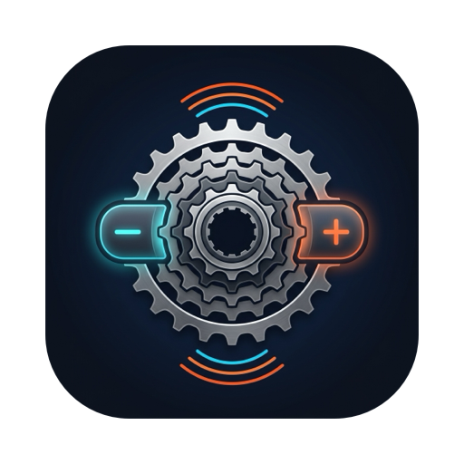
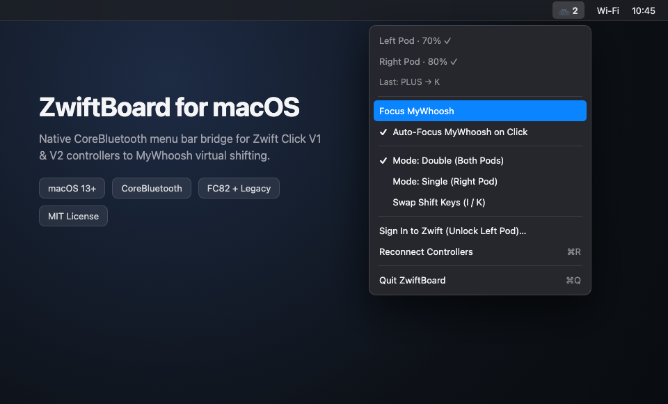

<div align="center">



# ZwiftBoard for macOS

**A lightweight, native macOS menu bar bridge for Zwift Click (V1 & V2) controllers on MyWhoosh.**

[-0a84ff?style=flat-square)](https://github.com/elmahdibihi/zwiftboard-mac/releases)
[](https://swift.org)
[](LICENSE)
[](https://github.com/elmahdibihi/zwiftboard-mac/releases/latest)

*Unofficial macOS app inspired by [thomaschampagne/zwiftboard](https://github.com/thomaschampagne/zwiftboard).*

<br/>



</div>

---

## Why ZwiftBoard for macOS?

MyWhoosh supports virtual shifting (**MyShift**) via keyboard shortcuts (`I` / `K`), while Zwift Click controllers speak a proprietary Bluetooth Low Energy protocol (`FC82` / `00000001-...`). **ZwiftBoard** sits quietly in your macOS menu bar and translates every Click press into clean, low-latency keystrokes.

- **Native `CoreBluetooth` + `AppKit`** — zero Electron, Python, or background runtime bloat
- **Click V1 & V2 Ready** — discovers all Zwift GATT services (`FC82` & legacy), deduplicates mirrored Left/Right pod frames (`HoldTracker`), and enforces a 30ms minimum tap hold for Unreal Engine frame polling
- **Idle-Proof & Battery-Safe** — tracks all inbound pod heartbeats, handles scheduled `0x18` idle resets with 12s zombie recovery + OS-level hardware auto-reconnect, and automatically disconnects all pods and quits when MyWhoosh closes
- **Pre-Ride Test & Auto-Fix Window** — opens automatically before MyWhoosh starts (or via `⌘T` in the menu bar) with a 30-gear shift simulator that verifies both BLE signal and macOS HID keystroke delivery end-to-end, plus one-click Accessibility/Bluetooth TCC repair
- **Safe MyWhoosh Mapping** — never maps `Enter` or `Space` (preventing accidental MyWhoosh HUD clicks or pauses), and works with 1 pod or both pods out of the box

---

## MyWhoosh Keymap Presets

| Preset | Controller Buttons | Key Sent | MyWhoosh Action |
| :--- | :--- | :--- | :--- |
| **Shifting Only (Safe)** *(Default)* | `PLUS` or `Y` | `K` *(swappable)* | Shift Up (Harder) |
| **Shifting Only (Safe)** *(Default)* | `MIN` or `B` | `I` *(swappable)* | Shift Down (Easier) |
| **Shifting + Steering** | `PLUS` | `K` *(swappable)* | Shift Up (Harder) |
| **Shifting + Steering** | `MIN` or `B` | `I` *(swappable)* | Shift Down (Easier) |
| **Shifting + Steering** | `LEFT` / `Z` · `RIGHT` / `A` | `←` / `→` | Steer Left / Right |
| **Shifting + Steering** | `Y` | `U` | Toggle Minimal HUD |

> **One-Pod / No-Login Tip:** On Click V2, the **Right Pod** (`PLUS`, `B`, `Y`) works indefinitely without signing in to Zwift (`PLUS`/`Y` = Harder, `B` = Easier). Only sign in via **Sign In to Zwift (Unlock Left Pod)…** if you also want the Left Pod's `MIN` and arrow buttons to stay unlocked past ~1 minute.

---

## Quick Install

1. Download **`ZwiftBoard-macOS.zip`** from [**Releases**](https://github.com/elmahdibihi/zwiftboard-mac/releases/latest).
2. Unzip and move **`ZwiftBoard.app`** into `/Applications`.
3. Open `ZwiftBoard.app` *(if macOS Gatekeeper warns on first launch, right-click → **Open**, or run `xattr -cr /Applications/ZwiftBoard.app`)*.
4. Allow **Bluetooth** when prompted, then click the **bicycle icon** in the menu bar → **⚠️ Grant Accessibility Permission** (required by macOS to send keystrokes to MyWhoosh).

### MyWhoosh Checklist
- Pair your smart trainer under **Power & Controllable / Resistance** in MyWhoosh.
- Start a **Free Ride** (virtual gears are disabled in ERG-mode workouts).

---

## Build from Source

Requires **macOS 13+** and **Swift 6+** (Xcode Command Line Tools):

```bash
git clone https://github.com/elmahdibihi/zwiftboard-mac.git
cd zwiftboard-mac
./build.sh
```

This compiles the release binary in an isolated temp directory, packages and ad-hoc signs `ZwiftBoard.app`, and outputs `dist/ZwiftBoard-macOS.zip` (pass `./build.sh --install` to also install directly to `/Applications/ZwiftBoard.app`).

---

## License

MIT — see [LICENSE](LICENSE).
